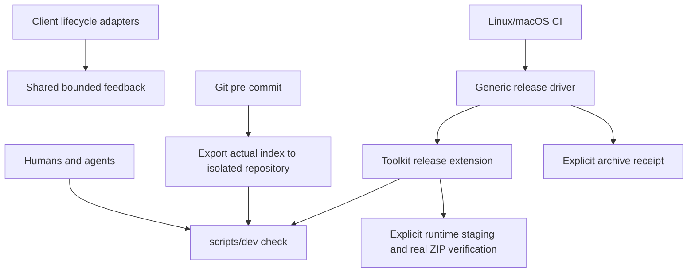

# Agent-neutral development architecture

[AGENTS.md](../AGENTS.md) is the canonical human/agent contract. Root CLAUDE.md imports
it; Codex discovers it directly. [Setup and recovery](development.md),
[client scope](hook-scope.md) and [acceptance evidence](verification/shared-ai-setup.md)
complete the operational contract. Update implementation, source contracts, tests
and documentation in the same PR. No private memory or conversation is required.

## Ownership and data flow

| Authoritative source | Responsibility |
| --- | --- |
| `scripts/dev`, `scripts/dev.py` | Checkout resolution, command dispatch, deterministic checks, index isolation, hook adaptation, diagnostics and toolkit package selection |
| `config/toolchain.json`, `.python-version`, `pyproject.toml`, `uv.lock` | Supported executable minimums, managed interpreter and pinned/hash-locked Python dependencies |
| `tools/pa-devtools`, `config/development.json` | Reusable parsers/index/hooks/specifications/planning and repository-declared gates/impacts |
| `config/package-files.json` | Explicit tracked runtime file inventory; new files require a review decision |
| `config/release.json` | Toolkit extension selecting shared check and package commands |
| `skills/plugin-release/scripts/release.py` and [shared runbook](../skills/plugin-release/references/runbook.md) | General release identity, extension/fallback selection, archive receipt and publication sequence |
| `skills/plugin-release/scripts/package.sh` | Low-level generic ZIP writer; never the standalone release preflight |
| `skills/plugin-release/scripts/branch-guard.py` | Reusable destination-aware main push policy and legacy generic guard installer |
| `.claude/settings.json`, `.codex/hooks.json` | Optional development event bindings; no independent policy implementation |
| `.github/workflows/release-checks.yml` | Conservative PR gate selection; full main/scheduled validation and real release dry-run; stable required statuses |

`check()` runs diagnostics, component schemas, shell/Python/CI lint and format
verification, Markdown links, README inventory, package-contract/link closure and
all infrastructure tests. Required failures stop execution. Format is an explicit
write operation. Lightweight client feedback checks syntax/shell style; it does not
replace the complete gate. The Git index and CI independently cover shell/MCP/hosted
writes outside native edit matchers. Current Codex code-mode native apply_patch
delivery was tested separately from arbitrary nested orchestration.

## Reuse and intentional differences from Organon

Reusable mechanics now live in the versioned `tools/pa-devtools` package; toolkit is
its first consumer. The [SDK, specification and CI contract](shared-devtools.md)
explains ownership, wheel installation, exact-SHA adoption and the read-only Organon/
marketplace comparison. No adjacent checkout is imported. Generic release orchestration
remains in the existing driver/runbook.

The official skills-ref core and Agent Plugins schema validate explicit profiles.
Strict raw YAML and toolkit invariants remain required. Claude-only fields are
validated and their projection is reported; the legacy package is not certified
portable. The required live gate resolves current authoritative versions online and fails on
unavailable sources or invalid current contracts. See the
[live-specification procedure](shared-devtools.md#live-authoritative-specifications).

Kepano provenance pins, protected references, resync tokens, connector inventories,
vault lints, commands/Gemini bundles and token-scenario baselines are absent from this
repository. Inventing such gates would provide no evidence about its contents.
Skill wording, trigger quality, domain behavior and performance remain review/live
test concerns under #14; no synthetic token budget is represented as measured usage.

## Index and hook contracts

The staged checker rejects main/detached HEAD and unmerged indexes, writes the staged
Git tree, exports staged bytes/modes, initializes a temporary repository, fetches
committed HEAD and reads the staged tree into its isolated index. An object alternate
provides staged blobs without modifying the real index. Inherited `GIT_*` variables
are stripped for all isolated subprocesses. Both staged and unstaged whitespace checks
run there. An unstaged repair cannot hide malformed staged content. Temporary storage
is cleaned on success or failure; neither the branch nor source files are changed.

Installation preflights both hook destinations before writing either. Relative or
absolute `core.hooksPath` and shared linked-worktree metadata are resolved by Git.
Exact generated v1 launchers and exact legacy toolkit branch-guard bodies are the
only automatic migration inputs. Marker substrings do not authorize replacement.
Unmanaged files and final hook symlinks are preserved. New launchers resolve the
invoking worktree at event time, never the installation checkout. Pre-push delegates
to the generic destination guard, including deletes and multiple updates. Old
worktrees without scripts/dev fail with an update/recovery instruction.

Local hooks are not a security boundary. Git options can bypass them; independently
required protected-main CI is the merge boundary. Installation is not a CI dependency.

## Packaging and release

The allowlist names regular tracked files individually. Arbitrary new/untracked files
inside a runtime directory are excluded. Missing, duplicate, unsafe, development,
local-artifact and symlink inputs fail. All runtime skills, agents and shared release
resources must remain selected. Runtime Markdown links are checked against staged
payloads, so omitted linked resources fail before building. Source-only development
links use repository URLs in shipped documentation.

The generic extension executes `release-check` once (clean tree plus full gate), then
`package` (private staging, low-level packager, exact ZIP inventory/integrity/source-byte
verification). This avoids duplicate heavy gates **within the same invocation**;
it does not reuse checks from earlier commits or a bump PR. Both release-driver modes
verify a real archive. Output and JSON receipt stay outside source. Exact merged
remote-main verification remains mandatory in the general runbook before tagging.
No release request is implied by implementation or CI.

The fallback remains available to other repositories without an extension. An existing
malformed extension fails closed, including nonobjects, boolean schema versions,
empty commands and broken symlinks. One-pass placeholder replacement, literal braces,
explicit archive receipts and failure propagation retain regression coverage.

## CI ownership and maintenance

The existing `Release checks (ubuntu-latest)` and `Release checks (macos-latest)`
contexts always run with read-only contents/actions permissions. PRs select gates only
after proving an unchanged engine/policy and successful exact-base full main-push
workflow. Missing proof and unknown changes force the full generic release dry-run.
Main pushes, weekly schedule, manual dispatch and releases remain full. The protected
macos-latest name still selects macos-15 with explicit ARM64/arm64 assertions and no
Intel fallback. Tool bootstrap remains uv 0.13.7/Python 3.11, shell tools, Linux
Go-installed actionlint v1.7.12 and macOS Homebrew actionlint.
See [selection and trust](shared-devtools.md#selective-ci-trust-and-execution).

Server protection is separate: PRs, strict required matrix checks, admin enforcement,
no force pushes/deletion. Never rename a required context without coordinating the
server migration. Current live readback is recorded in the acceptance report.

| Change | Update together | Verification |
| --- | --- | --- |
| New check/schema field | Shared function, docstrings, schema boundaries, fixtures | Failure/pass regression, full gate and index check |
| Dependency | Exact pyproject requirement, uv lock, tool policy, CI/bootstrap docs | Locked sync, missing/old/cache failures, both OS checks |
| Native event/payload | Central normalization, thin bindings, hook scope | Payload tests **and** fresh client delivery/feedback evidence |
| Runtime resource | Explicit file inventory and owning skill/agent documentation | Contract/link closure and actual archive equality/bytes |
| Release behavior | General driver/runbook and consumer extension only as needed | Both modes, fallback, errors, braces and receipts |
| Hook lifecycle | Installer/body recognition and recovery docs | Unmanaged/shared/custom-path and old-branch tests |

Recovery procedures belong in [development.md](development.md). Issue coordination
and remaining client limits belong in the tracked [report](verification/shared-ai-setup.md).
